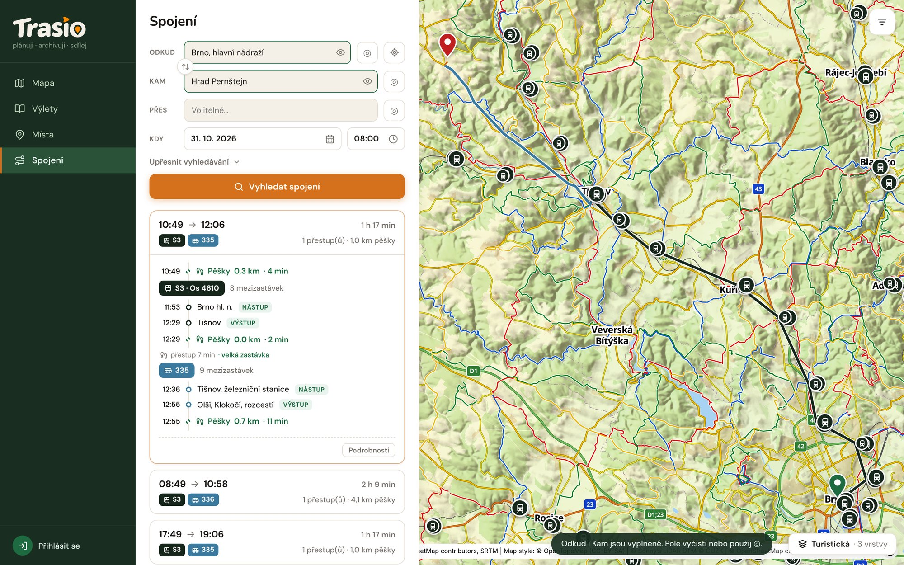

## Zadání

1. Otevři **Spojení**.
2. Vyplň **Odkud** a **Kam**. Můžeš psát název, nebo kliknout na ikonu ◎
   a vybrat místo v mapě. Ikona zaměřovače vyplní tvou polohu.
3. Volitelně vyplň **Přes**.
4. Nastav **Kdy** — datum a čas odjezdu.
5. Klikni na **Vyhledat spojení**.

## Ochota dojít pěšky

To je hlavní rozdíl proti běžným vyhledávačům. V části **Upřesnit
vyhledávání** nastavíš, kolik kilometrů jsi ochoten dojít pěšky. Trasio pak
hledá i zastávky v tomto okruhu, nejen tu nejbližší.

Delší chůze často znamená rychlejší spoj: vlak místo autobusu, nebo spoj
bez přestupu. Když Trasio nic nenajde, zkus limit zvýšit.

V Upřesnit vyhledávání nastavíš také:

- **Prioritu** — doporučené, nejrychlejší, nejméně přestupů, nejméně chůze,
- **Dopravní prostředky** — vlak, autobus, tramvaj.

## Výsledky

Každé spojení ukazuje čas odjezdu a příjezdu, linky, počet přestupů a kolik
půjdeš pěšky. Po rozbalení vidíš všechny úseky: pěší úseky, nástup, výstup a
mezizastávky. Trasa spojení je zároveň v mapě.

> Tip: U každého místa v mapě je tlačítko **Spojení sem**. Vyplní cíl za tebe.
