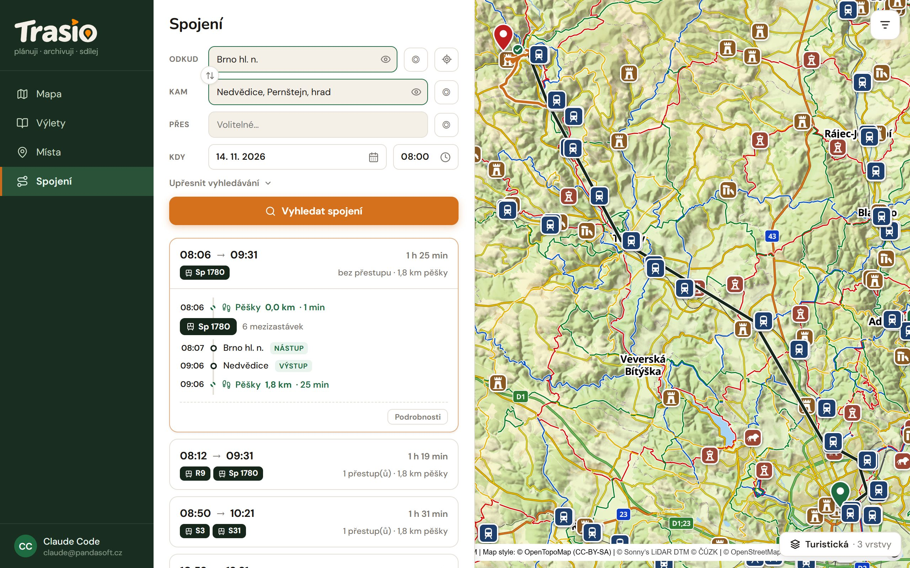

## Zadání

1. Otevři **Spojení**.
2. Vyplň **Odkud** a **Kam**. Můžeš psát název zastávky nebo adresu, nebo
   kliknout na ikonu ◎ a vybrat místo v mapě. Ikona zaměřovače vyplní tvou
   polohu. Šipkami mezi poli prohodíš odkud a kam.
3. Volitelně vyplň **Přes**.
4. Nastav **Kdy** — datum a čas odjezdu.
5. Klikni na **Vyhledat spojení**.

Místa, která máš uložená v profilu (**Moje místa**), se v polích nabízejí
jako první.

## Ochota dojít pěšky

To je hlavní rozdíl proti běžným vyhledávačům. V části **Upřesnit
vyhledávání** nastavíš **Ochotu dojít pěšky** v kilometrech. Trasio pak
hledá i zastávky v tomto okruhu, nejen tu nejbližší. Výchozí hodnotu
nastavíš v profilu.

Delší chůze často znamená rychlejší spoj: vlak místo autobusu, nebo spoj
bez přestupu. Když Trasio nic nenajde, zkus limit zvýšit.

V Upřesnit vyhledávání nastavíš také:

- **Prioritu** — Doporučené, Nejrychlejší, Nejméně přestupů, Nejméně chůze,
- **Chůze vs doprava** — Radši jezdím, Vyvážené, Radši chodím. „Radši
  chodím“ nabídne i spoje vlak + delší chůze.
- **Dopravní prostředky** — Vlak, Bus, Tram.

## Výsledky

Každé spojení ukazuje čas odjezdu a příjezdu, linky, počet přestupů a kolik
půjdeš pěšky. Po rozbalení vidíš všechny úseky: pěší úseky, nástup, výstup,
počet mezizastávek a upozornění na těsný přestup. Trasa spojení je zároveň
v mapě.

> Tip: U každého místa v mapě je tlačítko **Spojení sem**. Vyplní cíl za tebe.
