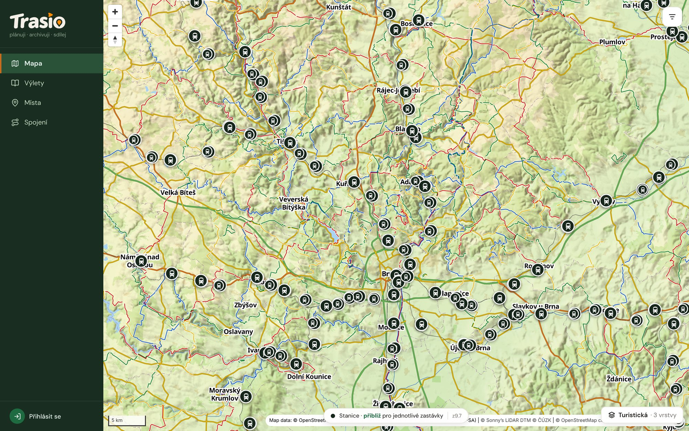

## Podkladová mapa

Vpravo dole vybereš podkladovou mapu:

- **Turistická** — vlastní mapa Trasia (výchozí),
- **Topografická** — klidnější mapa inspirovaná státní mapou,
- **Mapy.cz** — mapa od Seznam.cz. Ukáže se jen u účtů, kde ji provozovatel
  zapnul.

Ve vrstvách zapneš nebo vypneš **Turistické trasy**, **Cyklotrasy**,
**Reliéf** a **Vrstevnice**.

## Hledání a filtr

Panel **Hledání a filtr** vpravo nahoře má pole pro hledání výletu, místa
nebo stanice a tři části:

- **Výlety** — výlety ve výřezu mapy podle stavu (**Absolvované**,
  **Nové**, **Cizí**), podle data, délky a štítků. Archivované výlety jsou
  jen ve Výletech.
- **Místa** — zapne místa v mapě. Filtruješ **Chci navštívit**,
  **Navštívené** a **Nenavštívené** a v **Upřesnit výběr…** typy míst.
- **Doprava** — **Zastávky a stanice** a **Vozidla**. Vozidla ukazují
  spoje v reálném čase a vidí je jen přihlášení.

Panel jde minimalizovat. Zastávky uvidíš jednotlivě až po přiblížení mapy.

Místa a jejich návštěvy popisuje kapitola [Místa a návštěvy](../places/).
