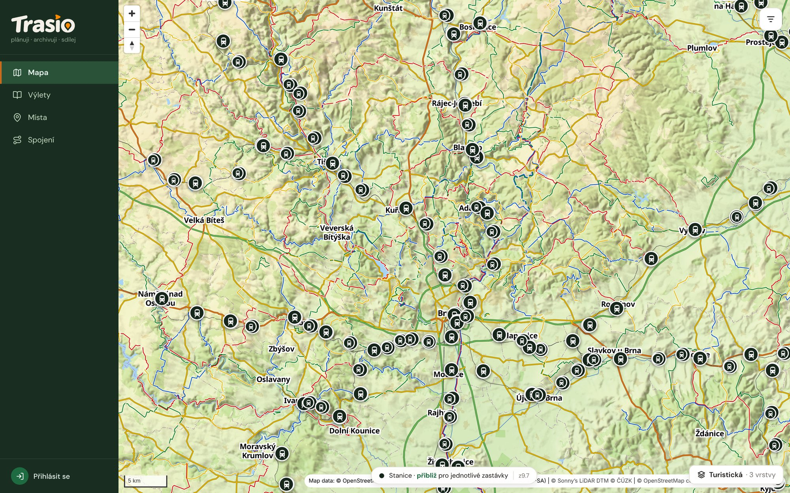
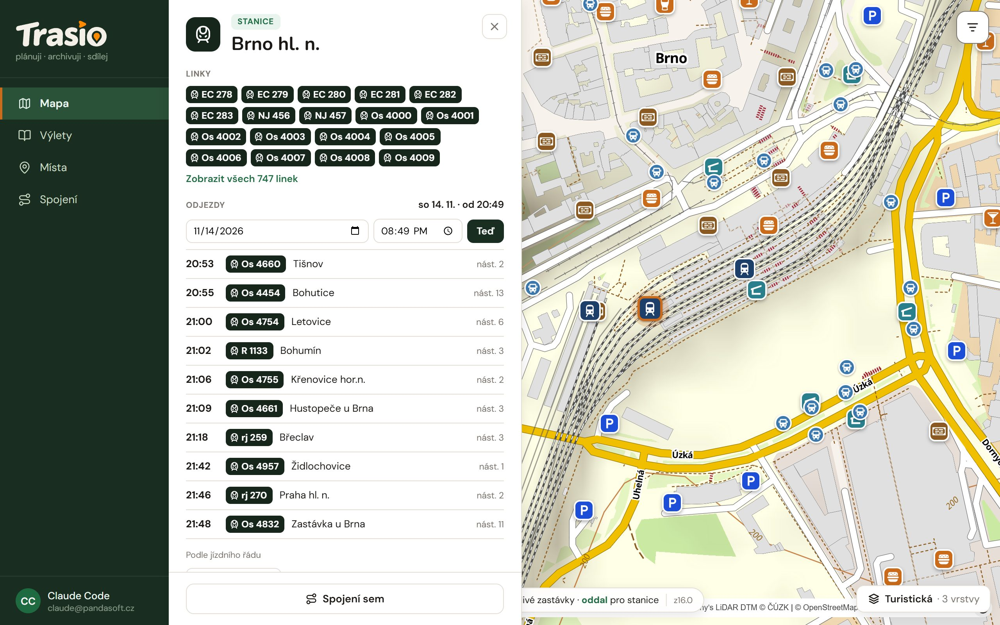
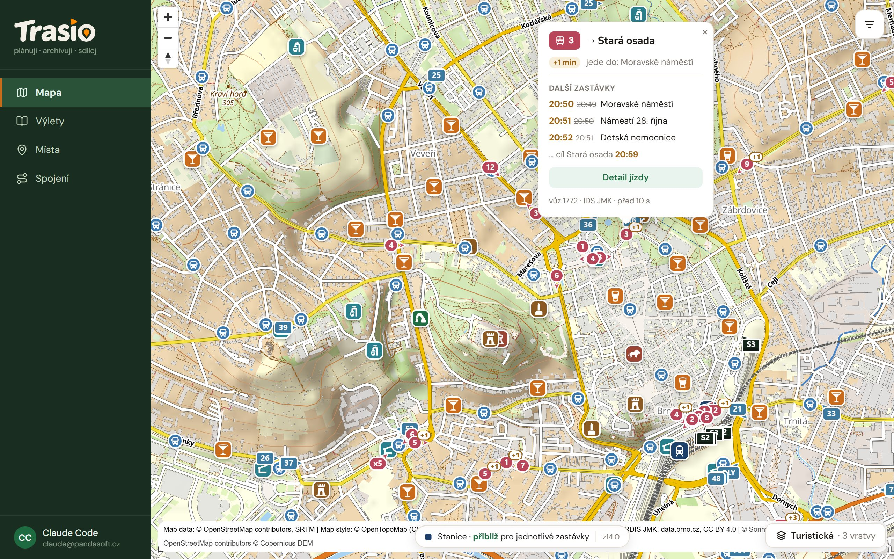

## Podkladová mapa

Vpravo dole vybereš podkladovou mapu:

- **Turistická** — vlastní mapa Trasia (výchozí),
- **Topografická** — klidnější mapa inspirovaná státní mapou,
- **Mapy.cz** — mapa od Seznam.cz. Ukáže se jen u účtů, kde ji provozovatel
  zapnul.

Ve vrstvách zapneš nebo vypneš **Turistické trasy**, **Cyklotrasy**,
**Reliéf** a **Vrstevnice**.

## Hledání a filtr

Panel **Hledání a filtr** vpravo nahoře má pole pro hledání výletu, místa
nebo stanice a tři části:

- **Výlety** — výlety ve výřezu mapy podle stavu (**Absolvované**,
  **Nové**, **Cizí**), podle data, délky a štítků. Archivované výlety jsou
  jen ve Výletech.
- **Místa** — zapne místa v mapě. Filtruješ **Chci navštívit**,
  **Navštívené** a **Nenavštívené** a v **Upřesnit výběr…** typy míst.
- **Doprava** — **Zastávky a stanice** a **Vozidla**. Vozidla ukazují
  spoje v reálném čase a vidí je jen přihlášení.

Panel jde minimalizovat. Zastávky uvidíš jednotlivě až po přiblížení mapy.

## Zastávky a odjezdy

Klikni na zastávku nebo stanici v mapě. Panel ukáže:

- **Linky**, které tu staví,
- **Odjezdy** s cílem a nástupištěm. Datum a čas změníš, tlačítko **Teď** se
  vrátí k aktuálnímu času. Kde je to možné, odjezd ukazuje i zpoždění.
- **V okolí** — místa a další zastávky poblíž,
- **Spojení sem**.

## Vozidla v reálném čase

Zapni v panelu **Hledání a filtr** přepínač **Vozidla**. Mapa pak ukáže
autobusy, tramvaje, trolejbusy a vlaky PID a IDS JMK tam, kde právě jsou.
Každé vozidlo má barvu podle druhu dopravy, číslo linky a štítek se
zpožděním, třeba „+1“.

Po kliknutí na vozidlo uvidíš, kam jede, zpoždění, další zastávky s časem
podle jízdního řádu i skutečným časem a **Detail jízdy**.

Místa a jejich návštěvy popisuje kapitola [Místa a návštěvy](../places/).
