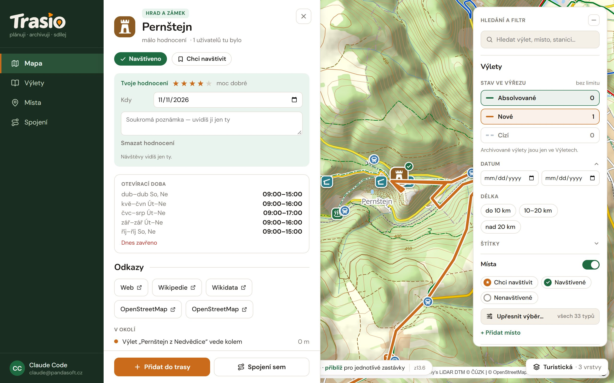

Místa jsou hrady a zámky, zříceniny, rozhledny, jeskyně, koupaliště,
pivovary, restaurace a další. Trasio si ke každému místu pamatuje, jestli ho
chceš navštívit, nebo jestli už jsi tam byl.

## Příklad: všechny hrady v okolí Brna

1. V **Mapě** otevři panel **Hledání a filtr**. U **Míst** klikni na
   **Upřesnit výběr…** a nech zapnutý jen typ **Hrad a zámek**.
2. Přibliž mapu na okolí Brna. Uvidíš všechny hrady v tomto výřezu.
3. Klikni na hrad. U hradů, které chceš vidět, zvol **Chci navštívit**.
4. Z hradu naplánuj výlet: **Přidat do trasy**, nebo jen **Spojení sem**.
5. Po výletě zvol **Označit jako navštívené**, zadej datum a dej
   hodnocení.

V části **Místa** na kartě **Moje místa** pak vidíš, co máš ještě před sebou
a co už máš za sebou.

## Detail místa

- **Chci navštívit** / **Označit jako navštívené** — tvůj stav místa.
- **Tvoje hodnocení** (1 až 5 hvězdiček), datum návštěvy (**Kdy**) a
  **soukromá poznámka**.
- **Otevírací doba**, **Odkazy** (web, Wikipedie, OpenStreetMap) a místa
  **V okolí**, včetně tvých výletů, které vedou kolem.
- **Přidat do trasy** a **Spojení sem**.

Ostatní uvidí jen průměr ze všech hodnocení. Tvoje návštěvy a poznámky
vidíš jen ty.

## Moje místa

Karta **Moje místa** v části **Místa** má tyto seznamy:

| Seznam | Co v něm je |
|---|---|
| **Moje návrhy** | Místa a opravy, které jsi poslal ke schválení. |
| **Soukromá místa** | Místa, která vidíš jen ty. |
| **Návštěvy** | Místa, kde jsi byl, s datem a hodnocením. |
| **Chci navštívit** | Místa, která máš před sebou. |
| **Hodnocení** | Místa, která jsi ohodnotil. |

## Přidat místo

Chybí místo v mapě? V panelu **Hledání a filtr** klikni na **+ Přidat
místo**, nebo na **Přidat místo** v Moje místa.

1. Klikni do mapy, kam místo patří.
2. Vyber, co to je (třeba **Vyhlídka**), a vyplň název.
3. Volitelně vyplň podrobnosti: placený vstup, otevírací dobu, adresu,
   telefon, přístup.
4. Zvol:
   - **Jen pro mě** — soukromé místo se uloží hned a na veřejné mapě
     nebude,
   - **Odeslat ke schválení** — správce návrh zkontroluje, pak se místo
     ukáže všem.

U existujícího místa najdeš v detailu **Navrhnout opravu** a **Nahlásit
místo**.

## Místa při plánování

Když v plánu rozbalíš bod, uvidíš **místa z okolí** v okruhu 250 m až 2 km.
Místo přidáš jedním klikem jako nový bod trasy. Viz [Plány a
výlety](../plans-and-trips/).

Které typy míst se na mapě ukazují, nastavíš v **Profilu** pod **Místa na
mapě**. Viz [Profil a nastavení](../profile/).
