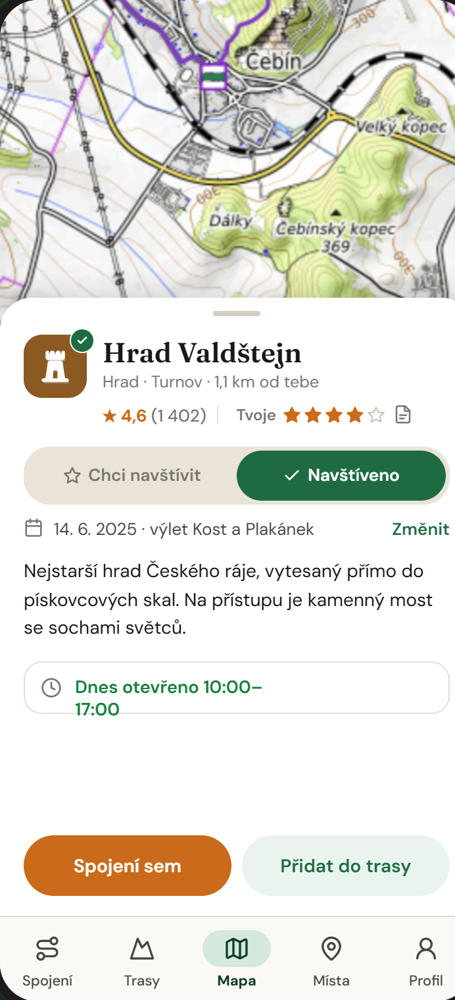

Místa jsou hrady, zříceniny, rozhledny, jeskyně, koupaliště, pivovary,
restaurace a další. Trasio si ke každému místu pamatuje, jestli ho chceš
navštívit, nebo jestli už jsi tam byl.

## Příklad: všechny hrady v okolí Brna

1. V **Mapě** nebo v části **Místa** otevři filtr a vyber typ **Hrad**.
2. Přibliž mapu na okolí Brna. Uvidíš všechny hrady v tomto výřezu.
3. U hradů, které chceš vidět, klikni na **Chci navštívit**.
4. Z hradu naplánuj výlet: **Přidat do trasy**, nebo jen **Spojení sem**.
5. Po výletě označ hrad jako **Navštíveno** a zadej datum.

V části **Místa** na kartě **Moje místa** pak vidíš, co máš ještě před sebou
a co už máš za sebou.

## Detail místa

- **Chci navštívit** / **Navštíveno** — tvůj stav místa.
- Tvoje **hodnocení** (hvězdičky) a **soukromá poznámka**.
- Datum návštěvy a výlet, na kterém jsi místo navštívil.
- **Spojení sem** a **Přidat do trasy**.

Veřejné je jen průměrné hodnocení. Tvoje návštěvy a poznámky jsou soukromé.

## Místa při plánování

Když v plánu rozbalíš bod, uvidíš **místa z okolí** v okruhu 250 m až 2 km.
Místo přidáš jedním klikem jako nový bod trasy.
