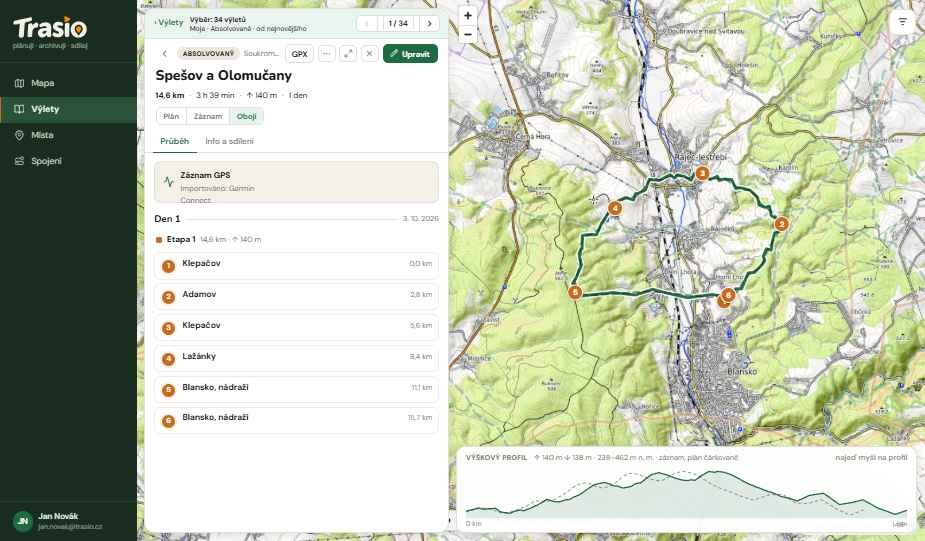
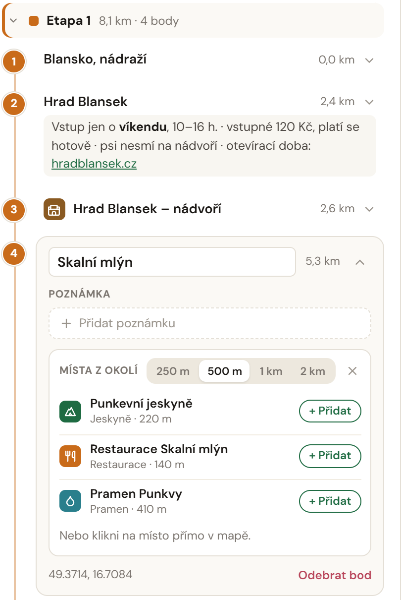

## Plán a výlet

**Plán** je šablona výletu. Nemá datum, takže ho můžeš použít kdykoli a
klidně víckrát. **Výlet** je plán, který jsi opravdu prošel — ten už datum má.

Každý výlet má stav:

| Stav | Význam |
|---|---|
| **Nový** | Naplánovaný, zatím neprojitý. |
| **Aktivní** | Právě ho jdeš. Aktivní může být jen jeden výlet. |
| **Absolvovaný** | Prošel jsi ho. Má datum. |
| **Archiv** | Odložený. Vidíš ho jen ty. |

Stav výletu vidíš jen ty. Ostatní ho neuvidí nikdy.

## Nový plán

1. V **Mapě** klikni na **Nový výlet**.
2. Klikej body trasy do mapy. Trasa mezi body vede po cestách.
3. Bod můžeš rozbalit: přidat poznámku, nebo místo z okolí.
4. Delší výlet rozděl na **dny** a **etapy**.

## Doprava v plánu

Plán má dopravu **tam**, **zpět** a případně **mezi etapami**. Každou
dopravu plánuješ jedním ze tří způsobů:

- **Den v týdnu** — orientační spojení pro tvůj oblíbený den (nastavíš v
  profilu, výchozí je neděle).
- **Konkrétní datum** — Trasio ověří skutečný jízdní řád.
- **Bez dopravy** — jedeš autem nebo na kole.

Plán s dopravou na konkrétní datum přidáš tlačítkem **Do kalendáře** do
svého kalendáře.

## Na výletě

- **Začít výlet** — výlet se stane aktivním.
- **Dokončit výlet** — výlet je absolvovaný a dostane dnešní datum.

## Záznam trasy

Záznam z hodinek nebo mobilu nahraješ jako **GPX** nebo **KML**. Detail
výletu pak ukáže **Plán**, **Záznam**, nebo **Obojí** a výškový profil.
Výlet můžeš také exportovat do GPX a otevřít v navigaci nebo v hodinkách.
