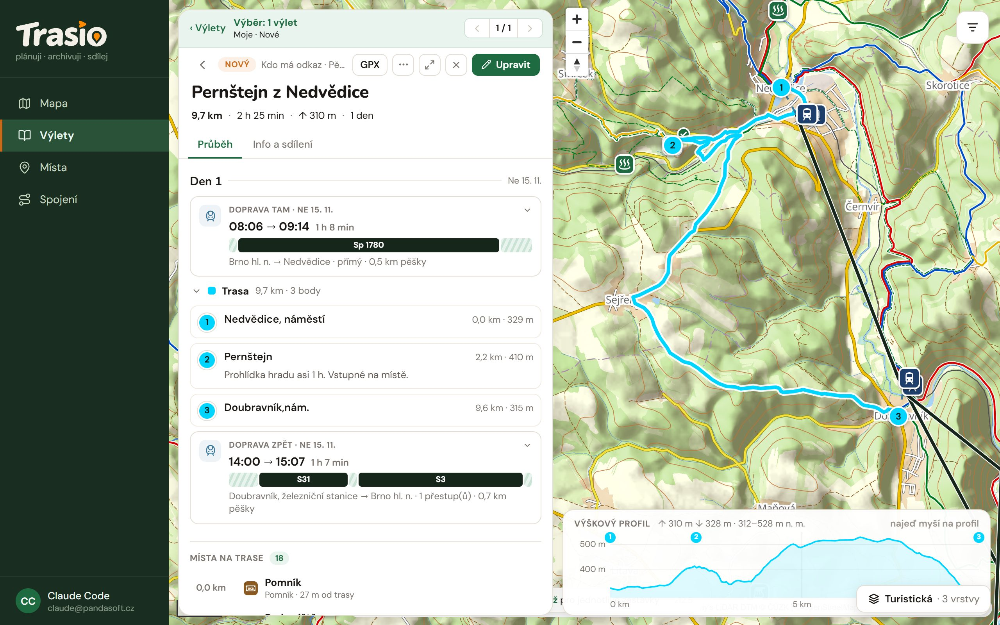
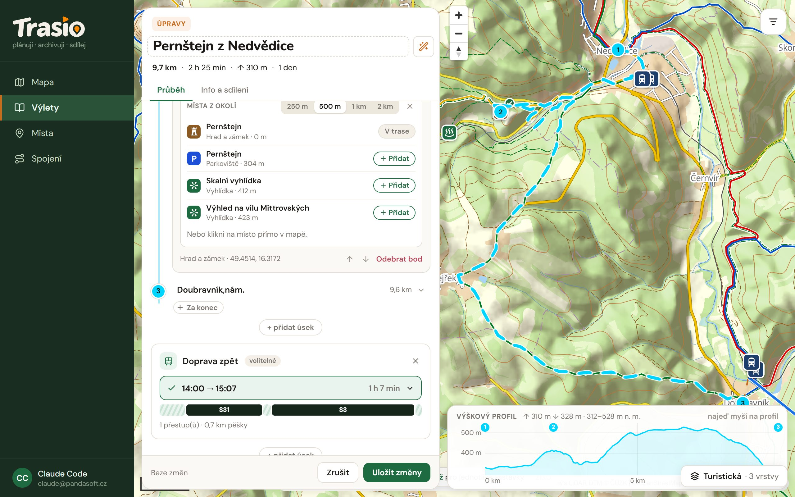
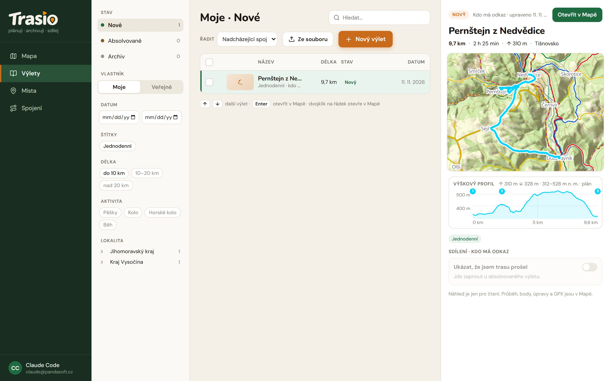

## Plán a výlet

**Plán** je šablona výletu. Nemá datum, takže ho můžeš použít kdykoli a
klidně víckrát. **Výlet** je plán, který jsi opravdu prošel — ten už datum má.

Každý výlet má stav:

| Stav | Význam |
|---|---|
| **Nový** | Naplánovaný, zatím neprojitý. |
| **Aktivní** | Právě ho jdeš. Aktivní může být jen jeden výlet. |
| **Absolvovaný** | Prošel jsi ho. Má datum. |
| **Archiv** | Odložený. Vidíš ho jen ty. |

Stav výletu vidíš jen ty. Ve sdíleném a veřejném výletu se nezobrazuje.

## Nový plán

1. V **Mapě** klikni na **Nový výlet**.
2. Nahoře vyplň název. Tlačítko s hůlkou vedle názvu ho vyplní podle
   začátku a konce trasy.
3. Klikej body trasy do mapy. Trasa mezi body vede po cestách. Body můžeš
   přetahovat, měnit jejich pořadí a vkládat mezi ně další.
4. Klikni na **Uložit změny**.

Plán se skládá z úseků v pořadí, jak jdou za sebou: **Doprava tam**,
**Trasa** a **Doprava zpět**. Dopravu zadat nemusíš. Klidně začni jen
trasou a spoj dohledej později.

U trasy vybereš aktivitu: **Pěší**, **Kolo**, **Kolo — terén** nebo
**Běh**. Podle ní Trasio vede trasu a počítá čas.

Tlačítkem **+ přidat úsek** přidáš další část výletu:

- **+ Doprava / přesun** — třeba vlak do dalšího města,
- **+ Pěší trasa** — další etapa,
- **+ Další den** — začne nový den výletu.

## Body, poznámky a místa z okolí

V úpravách plánu bod rozbalíš kliknutím. Pak můžeš:

- **Přidat poznámku** — vstupné, otevírací dobu, kde se najíst, kde spát.
  Poznámka umí tučné písmo, kurzívu, odrážky a odkazy (Markdown). Vyplněná
  poznámka je vidět přímo v seznamu bodů.
- otevřít **Místa z okolí** v okruhu 250 m, 500 m, 1 km nebo 2 km a místo
  přidat do trasy tlačítkem **Přidat**,
- bod posunout výš nebo níž, nebo ho **Odebrat**.

Místo přidáš do trasy i přímo z mapy: klikni na něj a zvol **Přidat do trasy
jako bod**.

## Vícedenní výlet

Výlet může mít víc dní. Každý den má své etapy a každá etapa své body. Mezi
etapami může být doprava. Délku, čas a převýšení vidíš pro celý výlet i pro
každý den.

## Doprava v plánu

Každou dopravu plánuješ jedním ze tří způsobů:

- **Den v týdnu** — orientační spojení pro vybraný den. Výchozí je tvůj
  oblíbený den z profilu (na začátku neděle).
- **Konkrétní datum** — Trasio ověří skutečný jízdní řád.
- **Neřeším** — jedeš autem nebo na kole.

Vyplň **Odkud jedeš?**, případně **Kam jedeš?**, a čas **Odjezdu**. Pak
klikni na **Hledat spoje →** a vyber jedno spojení ze seznamu. U dopravy zpět
ti Trasio nabídne odjezd **Spočítat z trasy** — odhad podle délky trasy.

## Detail výletu

V detailu výletu vidíš dny, dopravu, body trasy a výškový profil. Část
**Místa na trase** ukazuje místa podél trasy a jak daleko od ní jsou.

Tlačítka nahoře:

- **GPX** — export trasy do navigace nebo do hodinek,
- **…** — **Nahrát záznam GPS** a **Do kalendáře**,
- **Upravit** — otevře úpravy plánu.

Do kalendáře přidáš jen plán, který má dopravu na konkrétní datum.

Trasio dává výletům štítky samo, třeba **Jednodenní**.

## Seznam výletů

V části **Výlety** jsou tvoje výlety rozdělené na **Nové**, **Absolvované**
a **Archiv**. Přepínač **Moje** / **Veřejné** ukáže tvoje výlety, nebo
veřejné výlety ostatních.

Vlevo filtruješ podle data, štítků, délky, aktivity a lokality (kraj,
okres). Výlet v seznamu ukáže náhled. Dvojklik, nebo **Otevřít v Mapě**,
ho otevře v mapě.

Tlačítkem **Ze souboru** založíš výlet ze souboru GPX nebo KML.

## Na výletě

Výlet začneš a dokončíš v [aplikaci pro Android](../android/), která
trasu zaznamená. Na webu stav změníš ručně v detailu výletu na kartě
**Info a sdílení**.

## Záznam trasy

Záznam z hodinek nebo mobilu nahraješ jako **GPX** nebo **KML** přes
**… → Nahrát záznam GPS**. Detail výletu pak ukáže **Plán**, **Záznam**,
nebo **Obojí** a výškový profil.

Záznamy, které jsi odmítl, nebo jejichž výlet jsi smazal, najdeš v
**Profilu** pod **Odmítnuté importy**. Odtud je obnovíš.
