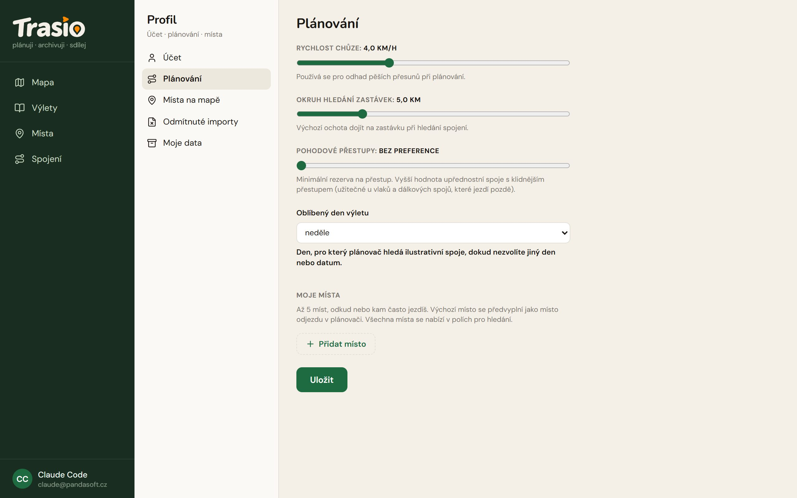
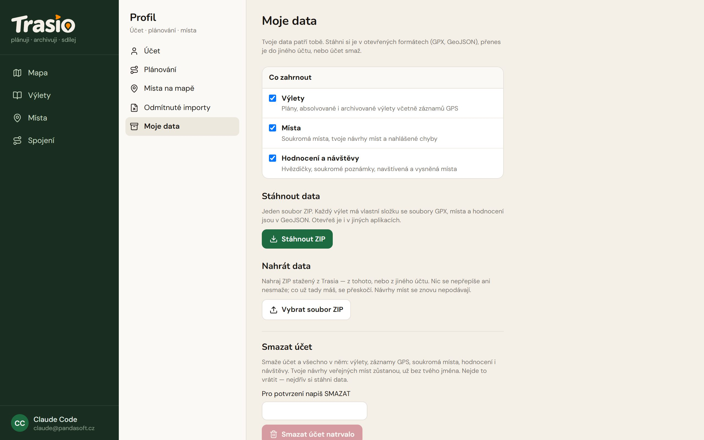

Profil otevřeš kliknutím na své jméno vlevo dole. Má pět částí.

## Účet

Tady vidíš svůj e-mail, **úroveň účtu** a kolik výletů máš uložených, třeba
„Start · 3 z 20 uložených výletů“. Změníš tu **Zobrazované jméno** a
odhlásíš se (**Odhlásit se**). Úrovně popisuje kapitola
[Začínáme](../getting-started/).

## Plánování

| Nastavení | K čemu je |
|---|---|
| **Rychlost chůze** | Odhad času pěších úseků (výchozí 4 km/h). |
| **Okruh hledání zastávek** | Výchozí ochota dojít na zastávku při hledání spojení (výchozí 5 km). |
| **Pohodové přestupy** | Minimální rezerva na přestup. Vyšší hodnota upřednostní spoje s klidnějším přestupem. |
| **Oblíbený den výletu** | Den, pro který plánovač hledá orientační spoje (výchozí neděle). |
| **Moje místa** | Až 5 míst, odkud nebo kam často jezdíš. Výchozí místo se předvyplní jako místo odjezdu. |

Změny ulož tlačítkem **Uložit**.

## Místa na mapě

Vybereš, které typy míst se ti ukazují na mapě (**Viditelnost na mapě**).
Až tři typy označíš hvězdičkou jako **Oblíbené typy** — ty se ukazují už
při menším přiblížení a jsou první v rychlém filtru.

## Odmítnuté importy

Záznamy, které jsi odmítl, nebo jejichž výlet jsi smazal. Znovu se
nenaimportují, dokud je tady neobnovíš.

## Moje data

Tvoje data patří tobě. V části **Moje data** je stáhneš, přeneseš do jiného
účtu, nebo účet smažeš.

V **Co zahrnout** vybereš, co chceš stáhnout nebo nahrát:

- **Výlety** — plány, absolvované i archivované výlety včetně záznamů GPS,
- **Místa** — soukromá místa, tvoje návrhy míst a nahlášené chyby,
- **Hodnocení a návštěvy** — hvězdičky, soukromé poznámky, navštívená místa
  a místa, která chceš navštívit.

**Stáhnout ZIP** stáhne jeden soubor ZIP. Každý výlet má vlastní složku se
soubory GPX, místa a hodnocení jsou v GeoJSON. Otevřeš je i v jiných
aplikacích. V souboru není tvůj e-mail.

**Vybrat soubor ZIP** nahraje data stažená z Trasia, z tohoto nebo z jiného
účtu. Nic se nepřepíše ani nesmaže, co už v účtu máš, se přeskočí. Nahrané
výlety jsou soukromé a návrhy míst se znovu neposílají.

**Smazat účet natrvalo** smaže účet a všechno v něm: výlety, záznamy GPS,
soukromá místa, hodnocení i návštěvy. Tvoje návrhy veřejných míst zůstanou,
už bez tvého jména. Pro potvrzení napiš SMAZAT. Smazání nejde vrátit, proto
si nejdřív stáhni data.
