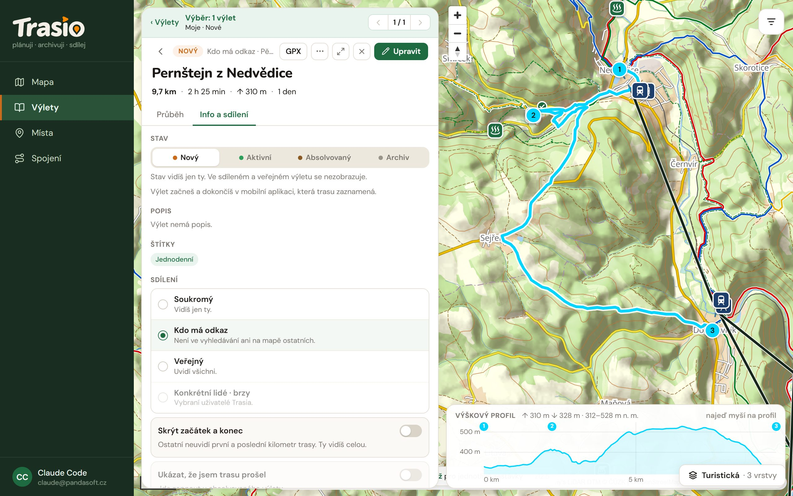

## Viditelnost výletu

V detailu výletu na kartě **Info a sdílení** nastavíš, kdo výlet uvidí:

| Volba | Kdo výlet uvidí |
|---|---|
| **Soukromý** | Jen ty. |
| **Kdo má odkaz** | Kdo dostane odkaz. Výlet není ve vyhledávání ani na mapě ostatních. |
| **Veřejný** | Všichni. |

Volba **Konkrétní lidé** (vybraní uživatelé Trasia) přijde brzy.

## Sdílení odkazem

U volby **Kdo má odkaz** vytvoříš odkaz v části **Odkazy na sdílení**:

1. Vyber **Jen čtení**, nebo **Může upravovat**.
2. Vyber **Platnost**: bez konce, 7 dní, 30 dní, nebo vlastní počet dní.
3. Klikni na **Vytvořit odkaz**.

Odkaz pak zkopíruješ (**Kopírovat**), nebo pošleš přes **Sdílet**,
**E-mail**, **WhatsApp**, **Facebook** nebo **Telegram**. Ikonou koše
odkaz zrušíš.

Kdo má odkaz pro úpravy, může plán měnit (po přihlášení). Kdo má odkaz pro
čtení, si může výlet **uložit k sobě** jako kopii.

## Skrýt začátek a konec

Volba **Skrýt začátek a konec** schová před ostatními první a poslední
kilometr trasy. Tak nikdo nepozná, kde bydlíš. Ty sám vidíš celou trasu.

## Ukázat, že jsem trasu prošel

Volba jde zapnout u absolvovaného výletu. Když je zapnutá, ostatní uvidí,
kdy jsi trasu prošel. Když je vypnutá, uvidí jen trasu, bez data průchodu.
U soukromého výletu nic nemění, protože ho nikdo jiný nevidí.
