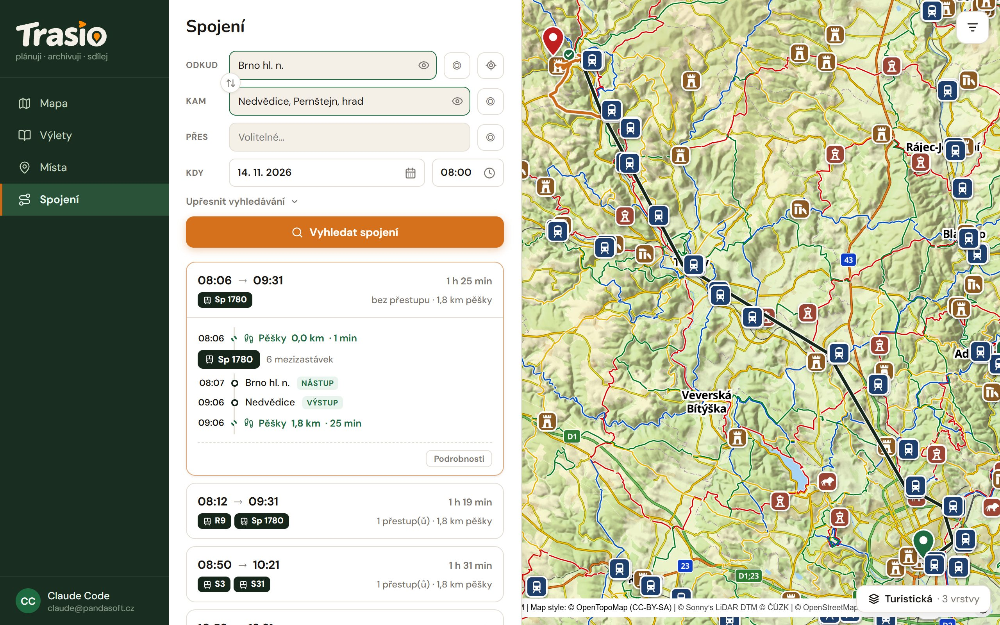

## Search

1. Open **Spojení** (Journeys).
2. Fill in **Odkud** (From) and **Kam** (To). Type a stop name or an
   address, or click the ◎ icon and pick a place on the map. The target
   icon fills in your location. The arrows between the fields swap From and
   To.
3. Optionally fill in **Přes** (Via).
4. Set **Kdy** (When) — date and time of departure.
5. Click **Vyhledat spojení** (Search).

The places saved in your profile (**Moje místa**, My places) come first in
the fields.

## Walking limit

This is the main difference from other journey planners. In **Upřesnit
vyhledávání** (Refine search) you set **Ochota dojít pěšky** (Walking limit)
in kilometres. Trasio then also looks for stops in this radius, not only the
nearest one. You set the default value in the profile.

A longer walk often means a faster journey: a train instead of a bus, or no
transfer. If Trasio finds nothing, try a higher limit.

In Refine search you can also set:

- **Priorita** (Priority) — Recommended, Fastest, Fewest transfers, Least
  walking,
- **Chůze vs doprava** (Walking vs transport) — Radši jezdím (Rather ride),
  Vyvážené (Balanced), Radši chodím (Rather walk). "Rather walk" also offers
  a train with a longer walk.
- **Dopravní prostředky** (Modes) — Vlak (Train), Bus, Tram.

## Results

Every journey shows departure and arrival, lines, transfers and how far you
walk. Open it to see all legs: walking, boarding, getting off, the number of
stops between and a warning for a short transfer. The journey is also drawn
on the map.

> Tip: Every place on the map has a **Spojení sem** (Journey here) button.
> It fills in the destination for you.
