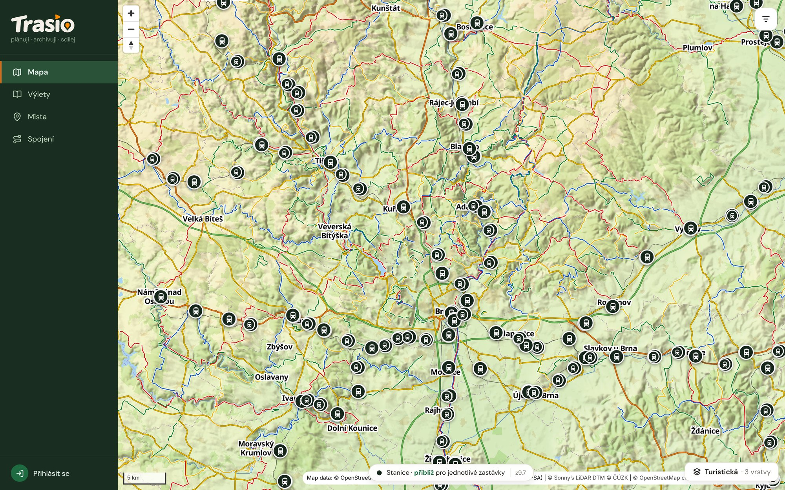

## Base map

Pick the base map at the bottom right:

- **Turistická** (Hiking) — Trasio's own map (default),
- **Topografická** (Topographic) — a calmer map inspired by the state map,
- **Mapy.cz** — the map by Seznam.cz.

In the layers you can turn **hiking routes**, **cycling routes**,
**relief** and **contour lines** on or off.

## Filter

The **Hledání a filtr** (Search and filter) panel shows the trips in the
map view by state (Walked, New, Others), by date, length and tags. It also
turns **places** and **stops and stations** on. You can minimise the panel.

Places and visits are in the chapter [Places and visits](../places/).
