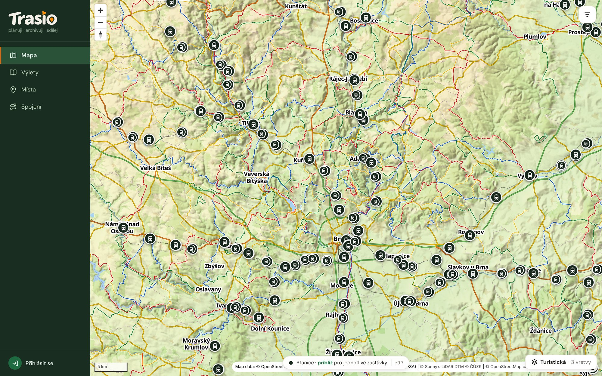

## Base map

Pick the base map at the bottom right:

- **Turistická** (Hiking) — Trasio's own map (default),
- **Topografická** (Topographic) — a calmer map inspired by the state map,
- **Mapy.cz** — the map by Seznam.cz. It shows only for accounts where the
  operator turned it on.

In the layers you can turn **Turistické trasy** (Hiking routes),
**Cyklotrasy** (Cycling routes), **Reliéf** (Relief) and **Vrstevnice**
(Contour lines) on or off.

## Search and filter

The **Hledání a filtr** (Search and filter) panel at the top right has a
field to search for a trip, a place or a station, and three parts:

- **Výlety** (Trips) — the trips in the map view by state (**Absolvované**,
  Walked; **Nové**, New; **Cizí**, Others), by date, length and tags.
  Archived trips are only in Trips.
- **Místa** (Places) — turns places on the map on. You filter **Chci
  navštívit** (Want to visit), **Navštívené** (Visited) and **Nenavštívené**
  (Not visited), and the place types in **Upřesnit výběr…** (Refine
  selection).
- **Doprava** (Transport) — **Zastávky a stanice** (Stops and stations) and
  **Vozidla** (Vehicles). Vehicles show live positions and are only for
  signed-in users.

You can minimise the panel. Single stops show when you zoom in.

Places and visits are in the chapter [Places and visits](../places/).
