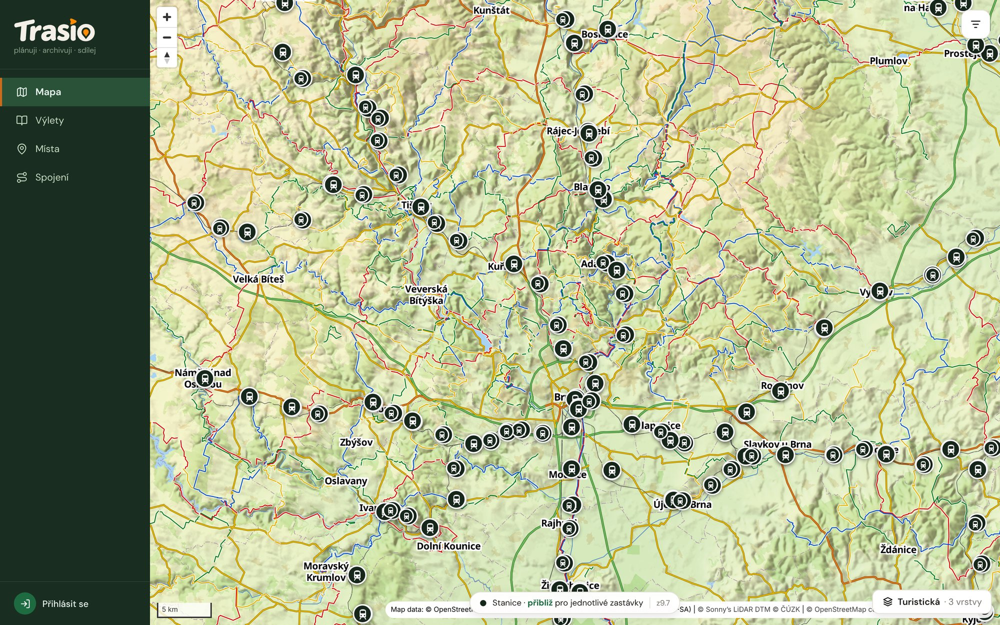
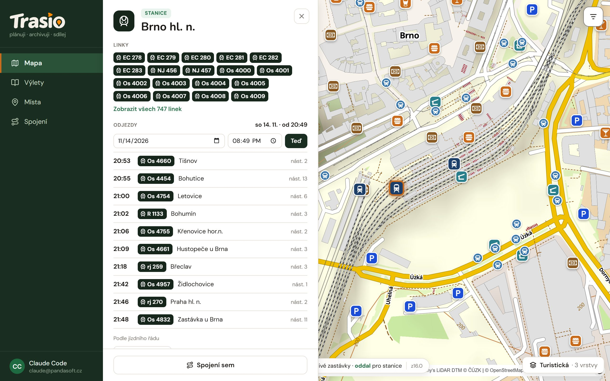
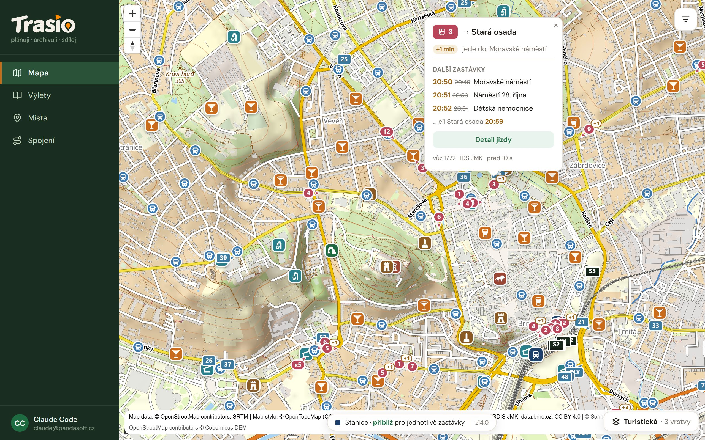

## Base map

Pick the base map at the bottom right:

- **Turistická** (Hiking) — Trasio's own map (default),
- **Topografická** (Topographic) — a calmer map inspired by the state map,
- **Mapy.cz** — the map by Seznam.cz. It shows only for accounts where the
  operator turned it on.

In the layers you can turn **Turistické trasy** (Hiking routes),
**Cyklotrasy** (Cycling routes), **Reliéf** (Relief) and **Vrstevnice**
(Contour lines) on or off.

## Search and filter

The **Hledání a filtr** (Search and filter) panel at the top right has a
field to search for a trip, a place or a station, and three parts:

- **Výlety** (Trips) — the trips in the map view by state (**Absolvované**,
  Walked; **Nové**, New; **Cizí**, Others), by date, length and tags.
  Archived trips are only in Trips.
- **Místa** (Places) — turns places on the map on. You filter **Chci
  navštívit** (Want to visit), **Navštívené** (Visited) and **Nenavštívené**
  (Not visited), and the place types in **Upřesnit výběr…** (Refine
  selection).
- **Doprava** (Transport) — **Zastávky a stanice** (Stops and stations) and
  **Vozidla** (Vehicles). Vehicles show live positions and are only for
  signed-in users.

You can minimise the panel. Single stops show when you zoom in.

## Stops and departures

Click a stop or a station on the map. The panel shows:

- **Linky** (Lines) that stop here,
- **Odjezdy** (Departures) with the destination and the platform. You can
  change the date and time; **Teď** (Now) goes back to the current time.
  Where possible, a departure also shows the delay.
- **V okolí** (Nearby) — places and other stops close by,
- **Spojení sem** (Journey here).

## Live vehicles

Turn on **Vozidla** (Vehicles) in the **Hledání a filtr** (Search and
filter) panel. The map then shows the buses, trams, trolleybuses and trains
of PID and IDS JMK where they are now. Every vehicle has the colour of its
mode, the line number and a delay tag, for example "+1".

Click a vehicle to see where it goes, its delay, the next stops with the
timetable time and the real time, and **Detail jízdy** (Trip detail).

Places and visits are in the chapter [Places and visits](../places/).
