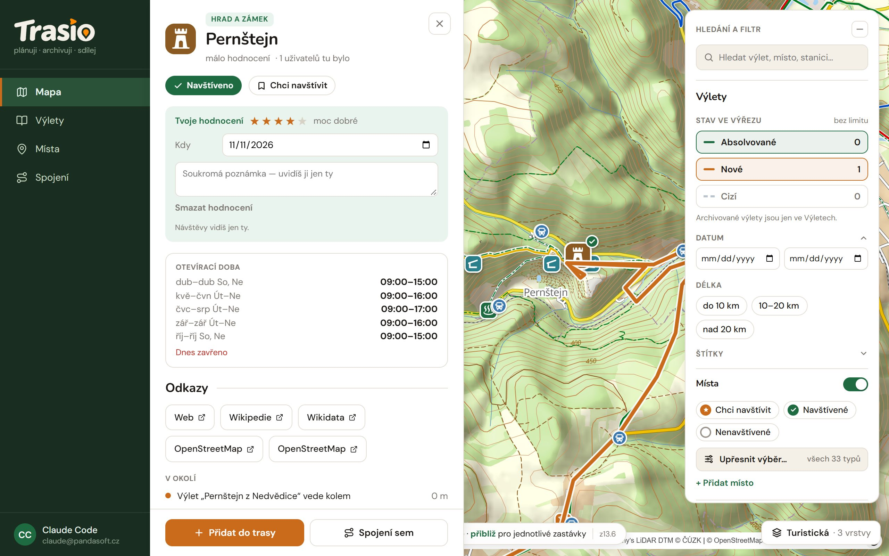

Places are castles, ruins, lookout towers, caves, swimming pools, breweries,
restaurants and more. For every place Trasio remembers if you want to visit
it, or if you have been there.

## Example: all castles around Brno

1. On the **Mapa** (Map) screen open the **Hledání a filtr** (Search and
   filter) panel. Under **Místa** (Places) click **Upřesnit výběr…** (Refine
   selection) and keep only the type **Hrad a zámek** (Castle and chateau).
2. Zoom the map to the Brno area. You see all castles in this view.
3. Click a castle. For the castles you want to see, choose **Chci
   navštívit** (Want to visit).
4. Plan a trip from a castle: **Přidat do trasy** (Add to route), or just
   **Spojení sem** (Journey here).
5. After the trip, choose **Označit jako navštívené** (Mark as visited), set
   the date and give a rating.

In **Místa** (Places), on the **Moje místa** (My places) tab, you see what is
still ahead of you and what you have done.

## Place detail

- **Chci navštívit** (Want to visit) / **Označit jako navštívené** (Mark as
  visited) — your state of the place.
- **Tvoje hodnocení** (Your rating, 1 to 5 stars), the visit date (**Kdy**,
  When) and a **private note**.
- **Otevírací doba** (Opening hours), **Odkazy** (Links: web, Wikipedia,
  OpenStreetMap) and places **V okolí** (Nearby), including your trips that
  go past.
- **Přidat do trasy** (Add to route) and **Spojení sem** (Journey here).

Others see only the average of all ratings. Only you see your visits and
notes.

## My places

The **Moje místa** (My places) tab in **Místa** (Places) has these lists:

| List | What is in it |
|---|---|
| **Moje návrhy** (My proposals) | Places and fixes you sent for review. |
| **Soukromá místa** (Private places) | Places that only you see. |
| **Návštěvy** (Visits) | Places where you have been, with date and rating. |
| **Chci navštívit** (Want to visit) | Places still ahead of you. |
| **Hodnocení** (Ratings) | Places you rated. |

## Add a place

Is a place missing on the map? In the **Hledání a filtr** (Search and
filter) panel click **+ Přidat místo** (Add place), or **Přidat místo** in My
places.

1. Click the map where the place is.
2. Pick what it is (for example **Vyhlídka**, Viewpoint) and type the name.
3. Optionally fill in the details: paid entry, opening hours, address,
   phone, access.
4. Choose:
   - **Jen pro mě** (Only for me) — the private place is saved at once and
     is not on the public map,
   - **Odeslat ke schválení** (Send for review) — an admin checks the
     proposal, then everyone sees the place.

For an existing place, the detail has **Navrhnout opravu** (Suggest a fix)
and **Nahlásit místo** (Report place).

## Places while planning

When you open a point in a plan, you see **places nearby** within 250 m to
2 km. One click adds a place as a new route point. See [Plans and
trips](../plans-and-trips/).

You choose which place types the map shows in **Profil** (Profile) under
**Místa na mapě** (Places on the map). See [Profile and
settings](../profile/).
