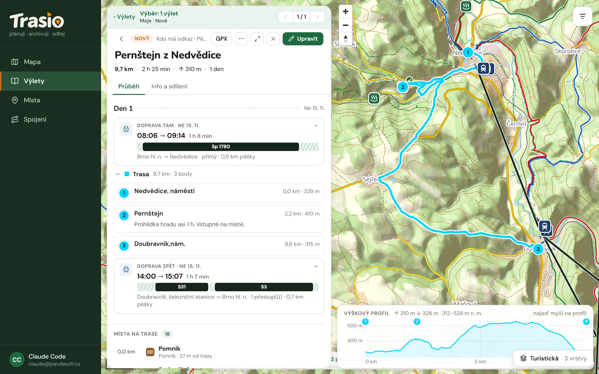
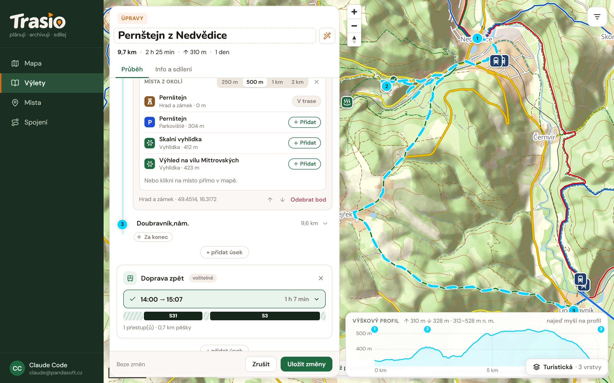
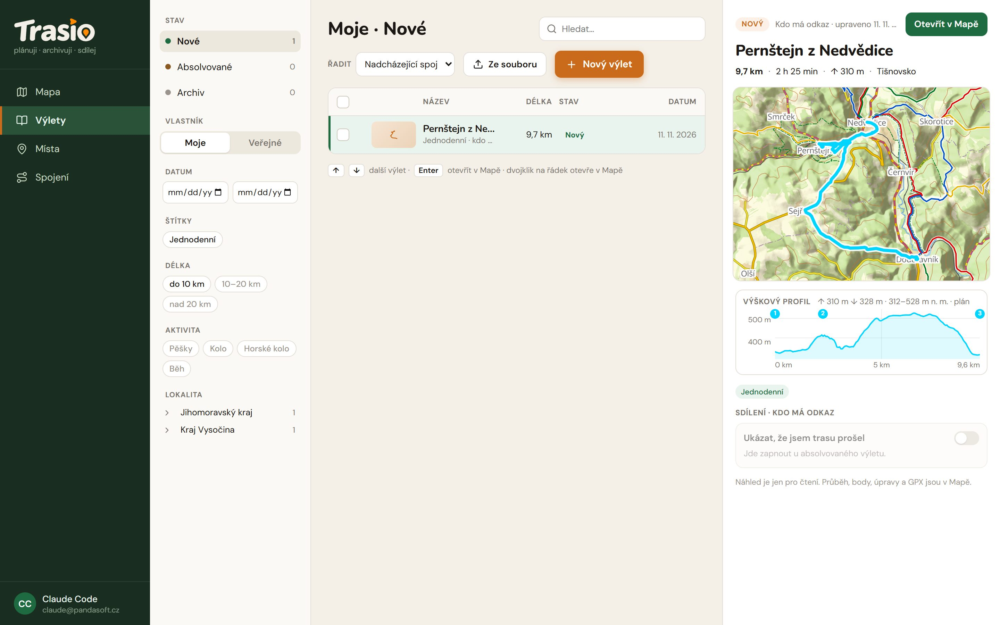

## Plan and trip

A **plan** is a trip template. It has no date, so you can use it at any time
and more than once. A **trip** is a plan that you really walked — it has a date.

Every trip has a state:

| State | Meaning |
|---|---|
| **Nový** (New) | Planned, not walked yet. |
| **Aktivní** (Active) | You are walking it now. Only one trip can be active. |
| **Absolvovaný** (Walked) | You walked it. It has a date. |
| **Archiv** (Archive) | Filed away. Only you see it. |

Only you see the state of a trip. A shared or public trip does not show it.

## New plan

1. On the **Mapa** (Map) screen click **Nový výlet** (New trip).
2. Type a name at the top. The magic wand button next to the name fills it
   in from the start and the end of the route.
3. Click the route points on the map. The route between points follows
   paths. You can drag points, change their order and insert new points
   between them.
4. Click **Uložit změny** (Save changes).

A plan is a list of parts in the order you go: **Doprava tam** (Transport
there), **Trasa** (Route) and **Doprava zpět** (Transport back). Transport is
optional. You can start with the route only and find the journey later.

For the route you pick the activity: **Pěší** (Walking), **Kolo** (Bike),
**Kolo — terén** (Mountain bike) or **Běh** (Running). Trasio uses it for
the routing and the time.

With **+ přidat úsek** (+ add part) you add another part of the trip:

- **+ Doprava / přesun** (Transport / transfer) — for example a train to
  the next town,
- **+ Pěší trasa** (Walking route) — another stage,
- **+ Další den** (Next day) — starts a new day of the trip.

## Points, notes and places nearby

While you edit a plan, click a point to open it. Then you can:

- **Přidat poznámku** (Add a note) — entry fee, opening hours, where to eat,
  where to sleep. A note can have bold and italic text, lists and links
  (Markdown). A filled note shows right in the list of points.
- open **Místa z okolí** (Places nearby) within 250 m, 500 m, 1 km or 2 km
  and add a place to the route with **Přidat** (Add),
- move the point up or down, or remove it with **Odebrat bod** (Remove
  point).

You can also add a place to the route right from the map: click it and
choose **Přidat do trasy jako bod** (Add to route as a point).

## Multi-day trip

A trip can have more days. Every day has its stages and every stage has its
points. Between stages there can be transport. You see length, time and
climb for the whole trip and for every day.

## Transport in a plan

You plan each transport in one of three ways:

- **Den v týdnu** (Day of week) — an example journey for the day you pick.
  The default is your preferred day from the profile (Sunday at first).
- **Konkrétní datum** (Exact date) — Trasio checks the real timetable.
- **Neřeším** (No transport) — you go by car or by bike.

Fill in **Odkud jedeš?** (From), maybe **Kam jedeš?** (To), and the
**Odjezd** (Departure) time. Then click **Hledat spoje →** (Find journeys)
and pick one journey from the list. For the transport back Trasio offers
**Spočítat z trasy** (Count from the route) — a departure time based on the
route length.

## Trip detail

The trip detail shows the days, the transport, the route points and the
elevation profile. **Místa na trase** (Places on the route) lists the places
along the route and how far from it they are.

The buttons at the top:

- **GPX** — export the route to a navigation app or a watch,
- **…** — **Nahrát záznam GPS** (Upload GPS track) and **Do kalendáře** (To
  calendar),
- **Upravit** (Edit) — opens the plan for editing.

Only a plan with transport on an exact date can go to the calendar.

Trasio adds some tags by itself, for example **Jednodenní** (One-day).

## List of trips

In **Výlety** (Trips) your trips are split into **Nové** (New),
**Absolvované** (Walked) and **Archiv** (Archive). The **Moje** (Mine) /
**Veřejné** (Public) switch shows your trips, or the public trips of others.

On the left you filter by date, tags, length, activity and area (region,
district). A trip in the list shows a preview. A double click, or
**Otevřít v Mapě** (Open in Map), opens it on the map.

**Ze souboru** (From file) creates a trip from a GPX or KML file.

## On the trip

You start and finish a trip in the [Android app](../android/), which
records the route. On the web you change the state by hand in the trip
detail, on the **Info a sdílení** (Info and sharing) tab.

## Track record

Upload a track from your watch or phone as **GPX** or **KML** with
**… → Nahrát záznam GPS** (Upload GPS track). The trip detail then shows
**Plán** (Plan), **Záznam** (Record) or **Obojí** (Both) and the elevation
profile.

Tracks that you rejected, or whose trip you deleted, are in **Profil**
(Profile) under **Odmítnuté importy** (Rejected imports). You can restore
them there.
