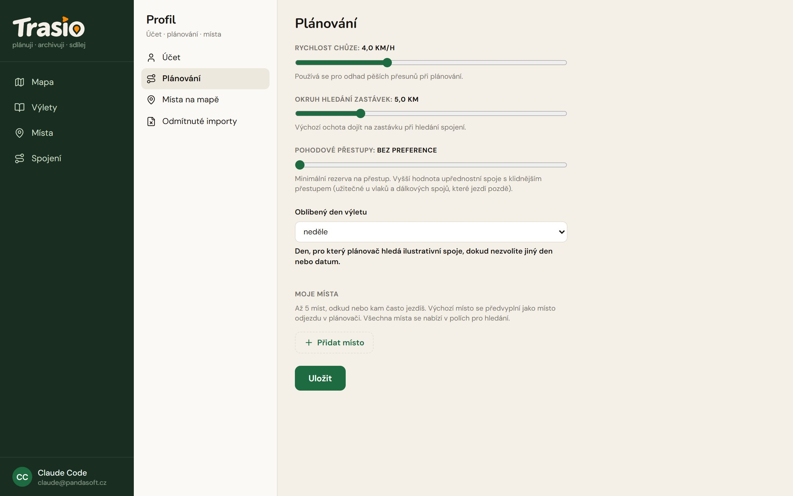

Open the profile with a click on your name at the bottom left. It has four
parts.

## Účet (Account)

Here you see your e-mail, your **account level** and how many trips you
have saved, for example "Start · 3 z 20 uložených výletů" (Start · 3 of 20
saved trips). You can change your **Zobrazované jméno** (Display name) and
sign out (**Odhlásit se**). The levels are in the chapter [Getting
started](../getting-started/).

## Plánování (Planning)

| Setting | What it is for |
|---|---|
| **Rychlost chůze** (Walking speed) | Time estimate for walking legs (default 4 km/h). |
| **Okruh hledání zastávek** (Stop search radius) | Default walking limit to a stop in journey search (default 5 km). |
| **Pohodové přestupy** (Relaxed transfers) | Minimum time for a transfer. A higher value prefers journeys with calmer transfers. |
| **Oblíbený den výletu** (Preferred trip day) | The day for which the planner looks for example journeys (default Sunday). |
| **Moje místa** (My places) | Up to 5 places you often travel from or to. The default place is filled in as the departure. |

Save the changes with **Uložit** (Save).

## Místa na mapě (Places on the map)

Choose which place types the map shows (**Viditelnost na mapě**, Visibility
on the map). Mark up to three types with a star as **Oblíbené typy**
(Favourite types) — they show already at a lower zoom and come first in the
quick filter.

## Odmítnuté importy (Rejected imports)

Tracks that you rejected, or whose trip you deleted. They are not imported
again until you restore them here.
