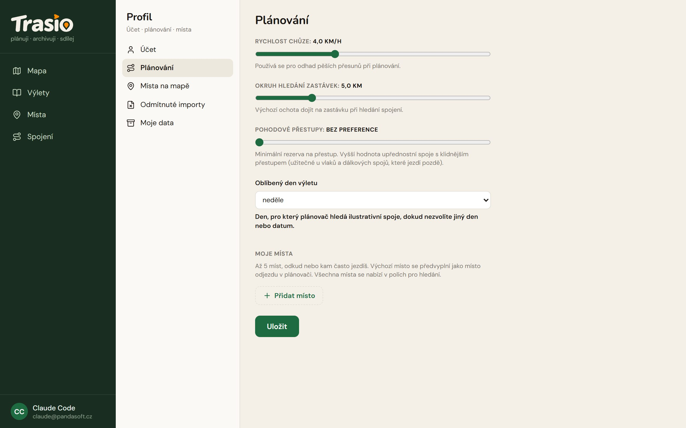
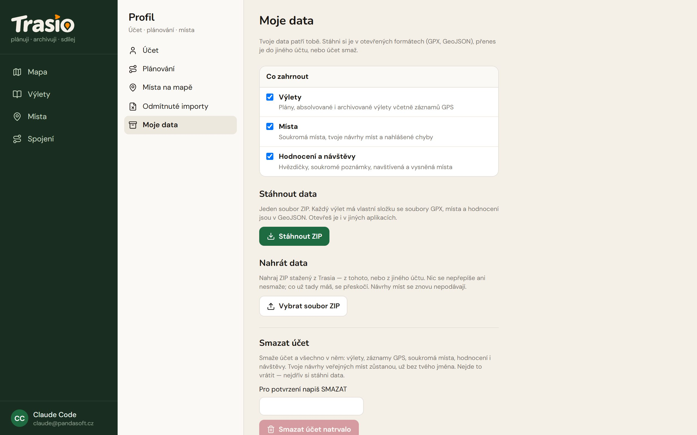

Open the profile with a click on your name at the bottom left. It has five
parts.

## Účet (Account)

Here you see your e-mail, your **account level** and how many trips you
have saved, for example "Start · 3 z 20 uložených výletů" (Start · 3 of 20
saved trips). You can change your **Zobrazované jméno** (Display name) and
sign out (**Odhlásit se**). The levels are in the chapter [Getting
started](../getting-started/).

## Plánování (Planning)

| Setting | What it is for |
|---|---|
| **Rychlost chůze** (Walking speed) | Time estimate for walking legs (default 4 km/h). |
| **Okruh hledání zastávek** (Stop search radius) | Default walking limit to a stop in journey search (default 5 km). |
| **Pohodové přestupy** (Relaxed transfers) | Minimum time for a transfer. A higher value prefers journeys with calmer transfers. |
| **Oblíbený den výletu** (Preferred trip day) | The day for which the planner looks for example journeys (default Sunday). |
| **Moje místa** (My places) | Up to 5 places you often travel from or to. The default place is filled in as the departure. |

Save the changes with **Uložit** (Save).

## Místa na mapě (Places on the map)

Choose which place types the map shows (**Viditelnost na mapě**, Visibility
on the map). Mark up to three types with a star as **Oblíbené typy**
(Favourite types) — they show already at a lower zoom and come first in the
quick filter.

## Odmítnuté importy (Rejected imports)

Tracks that you rejected, or whose trip you deleted. They are not imported
again until you restore them here.

## Moje data (My data)

Your data are yours. In **Moje data** (My data) you download them, move them
to another account, or delete the account.

In **Co zahrnout** (What to include) you pick what to download or upload:

- **Výlety** (Trips) — plans, walked and archived trips with their GPS
  tracks,
- **Místa** (Places) — private places, your place suggestions and the errors
  you reported,
- **Hodnocení a návštěvy** (Ratings and visits) — stars, private notes,
  visited places and places you want to visit.

**Stáhnout ZIP** (Download ZIP) downloads one ZIP file. Every trip has its own
folder with GPX files; places and ratings are in GeoJSON. Other apps can open
them too. The file does not contain your e-mail.

**Vybrat soubor ZIP** (Choose ZIP file) uploads data downloaded from Trasio,
from this account or another one. Nothing is overwritten or deleted; what
the account already has is skipped. Uploaded trips are private, and place
suggestions are not sent again.

**Smazat účet natrvalo** (Delete account forever) deletes the account and
everything in it: trips, GPS tracks, private places, ratings and visits. Your
suggestions of public places stay, without your name. To confirm, type
SMAZAT. It cannot be undone, so download your data first.
