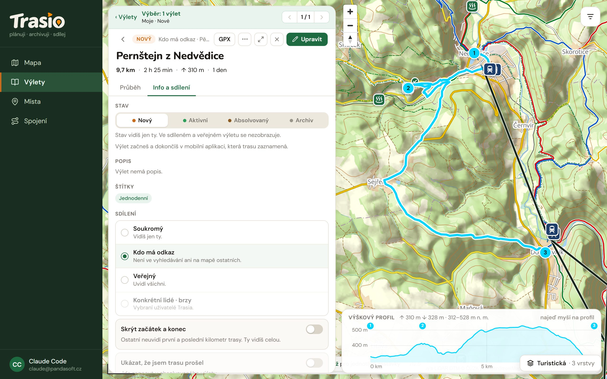

## Trip visibility

In the trip detail, on the **Info a sdílení** (Info and sharing) tab, you
set who sees the trip:

| Option | Who sees the trip |
|---|---|
| **Soukromý** (Private) | Only you. |
| **Kdo má odkaz** (Anyone with the link) | Anyone who gets the link. The trip is not in search or on other people's map. |
| **Veřejný** (Public) | Everyone. |

The option **Konkrétní lidé** (Specific people, chosen Trasio users) is
coming soon.

## Share with a link

With **Anyone with the link**, you make a link in **Odkazy na sdílení**
(Share links):

1. Pick **Jen čtení** (Read only), or **Může upravovat** (Can edit).
2. Pick **Platnost** (Valid for): no end, 7 days, 30 days, or your own
   number of days.
3. Click **Vytvořit odkaz** (Create link).

Then copy the link (**Kopírovat**, Copy), or send it with **Sdílet**
(Share), **E-mail**, **WhatsApp**, **Facebook** or **Telegram**. The bin
icon deletes the link.

Anyone with an edit link can change the plan (after signing in). Anyone with
a read link can **Uložit k sobě** (save a copy) of the trip.

## Hide the start and the end

The option **Skrýt začátek a konec** (Hide start and end) hides the first
and the last kilometre of the route from others. So nobody can see where you
live. You still see the whole route.

## Show that I walked the route

You can turn on **Ukázat, že jsem trasu prošel** (Show that I walked the
route) for a walked trip. When it is on, others see when you walked the
route. When it is off, they see only the route, without the date. For a
private trip it changes nothing, because nobody else sees it.
